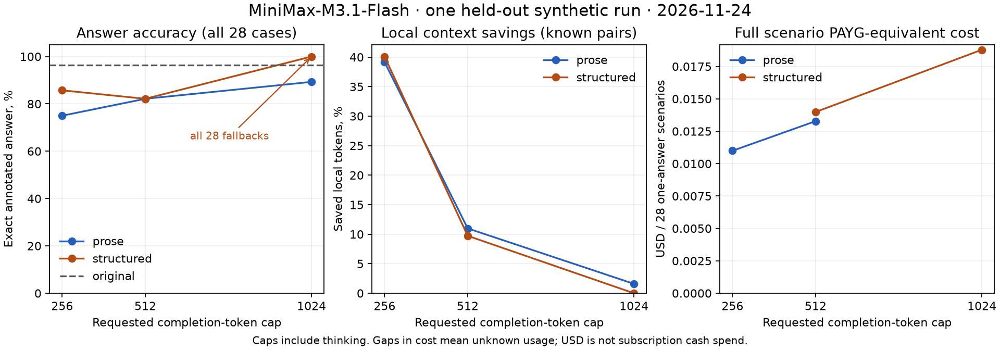

# MiniMax summary budget study — 2026-11-24

This is one real, descriptive run on a small synthetic dataset. It does not establish statistical significance or production reliability.

## Design and provenance

- Implementation commit: `1b7b7ba46c1e23007ae5ad6ca3e5e0ac809c95e1` (clean tree during both splits).
- Dataset `synthetic-ru-en-v1`; SHA-256 `f2708051f1dab34d4f38a5dfb70b5e8f50d057897b6c9ccc82b8e553672e5542`.
- Code/scoring SHA-256 `50549dcb34c8445da113828192410cf8851ba815e1ea3d5668caf4b309acf116`.
- Requested and returned model: `MiniMax-M3.1-Flash` for both separately configured roles; OpenAI-compatible Chat Completions endpoint `https://api.minimax.io/v1`.
- Same answer instructions and 512-token completion cap in every cell. `reasoning_effort=low`; effective temperature 1 (the provider ignores the temperature field). No retries or verification calls.
- Fixed grid: prose and structured instruction packages × 256/512/1024 completion tokens. Completion caps include reasoning and can truncate summaries; they are not visible-summary targets.
- Shared local `o200k_base` counter and approximate message framing; this is not MiniMax's tokenizer. `trigger_tokens=200`, `keep_recent=2`; final question remains unchanged. Ordinary optimize() and fallback are exercised.
- Four development cases (two RU/two EN; numbers, exceptions, updated facts, task status) selected the variant. Twenty-eight separate evaluation cases (14 RU/14 EN; seven categories × four) describe all six predeclared variants. Eval never reselects the winner.
- One baseline per case, rotating execution order, no discarded failures or cherry-picked repeats. Automatic cache state is observed, not controlled.
- Primary metric: exact annotated JSON answer accuracy. Secondary: mean per-case required-field recall, annotated forbidden claims, fallback, context size, latency and all provider usage. Labels are separate from both model inputs. Lexical context recall alone does not prove semantic retention; forbidden-claim checks cover only the annotations.
- Full settings, both instruction strings, exact execution order and per-call diagnostics are in the linked metadata and result files. Package versions: [environment.json](environment.json).

## Accounting

USD below is **published PAYG-equivalent cost**, not the subscription invoice or incremental cash spend. The key used a subscription plan. Rates checked on 2026-11-24: $0.15 input / $0.60 output / $0.015 cached input per million tokens ([official pricing](https://platform.minimax.io/docs/pricing/overview)). Reasoning is included in provider output usage. Summary and downstream calls, including rejected compactions, are charged. Missing usage/cost remains unknown, including timed-out requests; the known subtotal is never the complete cost when usage is missing.

Development: 52 calls; known subtotal $0.012073, 0 unknown-usage calls. Evaluation: 361 calls; known subtotal $0.081391, 4 unknown-usage calls. Setup probe: 1 call, $0.00001000 ([record](probe.json)).
Total including setup: 414 calls. Known subtotal $0.093474 PAYG equivalent; complete experiment cost is unknown if any call lacks usage.

## Development selection

Selection ranks eligible variants by exact accuracy, required-fact recall, fewer forbidden/unknown claims, local token savings, then known full cost. Eligibility requires accepted compaction and no errors. All-rejected variants cannot win. On dev, `structured-256` answered 4/4 correctly and was accepted 4/4; original history answered 4/4 correctly. These four examples omit three evaluation categories.

## Held-out evaluation



Accuracy includes every case, including fallback and errors. A/R/N/E means accepted/rejected/not triggered/optimization error; the Errors column also includes downstream errors. Local savings use only pairs with known output contexts; missing contexts are counted explicitly. Truncations are finish_reason=length, listed as summary/downstream. Each compaction row charges all attempted calls, even if no answer followed a failed summary.

| Variant | Correct | Fact recall (macro) | Forbidden / unknown | A/R/N/E | Errors | Local saved (known) / unknown | Length S/D | Calls | Full PAYG USD | Latency sum s |
| --- | ---: | ---: | ---: | --- | ---: | --- | --- | ---: | ---: | ---: |
| original | 27/28 | 96.4% | 0/1 | 0/0/0/0 | 1 | 0.0% / 0 | 0/0 | 28 | unknown (known subtotal 0.001739) | 122.5 |
| prose-256 | 21/28 | 79.2% | 0/0 | 28/0/0/0 | 0 | 39.2% / 0 | 28/0 | 56 | 0.010994 | 175.9 |
| prose-512 | 23/28 | 86.3% | 0/0 | 19/9/0/0 | 0 | 11.0% / 0 | 15/0 | 56 | 0.013278 | 211.8 |
| prose-1024 | 25/28 | 89.3% | 0/2 | 9/17/0/2 | 2 | 1.6% / 2 | 0/0 | 54 | unknown (known subtotal 0.012797) | 350.3 |
| structured-256 | 24/28 | 89.9% | 0/1 | 27/0/0/1 | 1 | 40.1% / 1 | 27/0 | 55 | unknown (known subtotal 0.009808) | 231.6 |
| structured-512 | 23/28 | 83.9% | 0/1 | 14/14/0/0 | 0 | 9.7% / 0 | 28/0 | 56 | 0.013984 | 281.4 |
| structured-1024 | 28/28 | 100.0% | 0/0 | 0/28/0/0 | 0 | 0.0% / 0 | 4/0 | 56 | 0.018790 | 315.4 |

Preselected `structured-256`: 24/28 correct versus 27/28 on original history; 4 paired regressions and 1 paired improvement. Accepted-only accuracy: 24/27 (descriptive subset; rejected cases remain in the primary metric). Full one-answer scenario cost is unknown because some usage is missing with the observed cache state.

The four exact-match regressions have different causes: one accepted summary omits all three required measurements; two answers differ only in exact string formatting (an added article and quotation marks); one summary request failed at the 60-second limit. The paired improvement is also operational: the original-history request failed, while the compacted request succeeded. These observations do not establish four semantic losses or a semantic improvement. All 27 completed original-history requests answered exactly correctly.

The `structured-1024` result of 28/28 is entirely fallback: all 28 summaries were rejected, so the downstream model received original histories after the additional summary cost. It demonstrates no successful compression at that budget in this run.

| Category | Original correct | Preselected correct | Preselected A/R |
| --- | ---: | ---: | --- |
| code_json | 4/4 | 4/4 | 4/0 |
| entity_ids | 4/4 | 4/4 | 4/0 |
| negations_exceptions | 4/4 | 3/4 | 4/0 |
| numbers_units | 4/4 | 3/4 | 4/0 |
| sources | 4/4 | 3/4 | 3/0 |
| task_status | 3/4 | 4/4 | 4/0 |
| updated_facts | 4/4 | 3/4 | 4/0 |

## Concrete selected-variant regressions

### numbers_units-ru-01 (accepted)

The truncated summary spent its budget on unrelated seminar instructions and ended at `## entity:` before retaining the three measurements. The original-history answer had all three values. Full summary text is retained in the raw row's `context`.

````json
{
  "expected": {
    "thickness": "0,75 мм",
    "roll_width": "1,20 м",
    "box_mass": "12,50 кг"
  },
  "original_answer": "{\"thickness\":\"0,75 мм\",\"roll_width\":\"1,20 м\",\"box_mass\":\"12,50 кг\"}",
  "compressed_answer": "{\"thickness\":\"\",\"roll_width\":\"\",\"box_mass\":\"\"}",
  "error": null,
  "finish_reasons": [
    {
      "stage": "summary",
      "finish_reason": "length"
    },
    {
      "stage": "downstream",
      "finish_reason": "stop"
    }
  ]
}
````

### negations_exceptions-en-01 (accepted)

````json
{
  "expected": {
    "copy_status": "forbidden",
    "exception": "encrypted research laptop with written custodian approval"
  },
  "original_answer": "{\"copy_status\":\"forbidden\",\"exception\":\"encrypted research laptop with written custodian approval\"}",
  "compressed_answer": "{\"copy_status\":\"forbidden\",\"exception\":\"an encrypted research laptop with written custodian approval\"}",
  "error": null,
  "finish_reasons": [
    {
      "stage": "summary",
      "finish_reason": "length"
    },
    {
      "stage": "downstream",
      "finish_reason": "stop"
    }
  ]
}
````

### updated_facts-ru-01 (accepted)

````json
{
  "expected": {
    "date": "21 ноября",
    "room": "Янтарь",
    "coordinator": "Олег"
  },
  "original_answer": "{\"date\":\"21 ноября\",\"room\":\"Янтарь\",\"coordinator\":\"Олег\"}",
  "compressed_answer": "{\"date\":\"21 ноября\",\"room\":\"«Янтарь»\",\"coordinator\":\"Олег\"}",
  "error": null,
  "finish_reasons": [
    {
      "stage": "summary",
      "finish_reason": "length"
    },
    {
      "stage": "downstream",
      "finish_reason": "stop"
    }
  ]
}
````

### sources-ru-01 (error)

````json
{
  "expected": {
    "retention_source": "https://docs.example.invalid/pine/retention-v3",
    "access_source": "https://docs.example.invalid/pine/access-v2"
  },
  "original_answer": "{\"retention_source\":\"https://docs.example.invalid/pine/retention-v3\",\"access_source\":\"https://docs.example.invalid/pine/access-v2\"}",
  "compressed_answer": "",
  "error": "ModelError",
  "finish_reasons": [
    {
      "stage": "summary",
      "finish_reason": null
    }
  ]
}
````


## Decision and limits

Ship the reproducible benchmark and evidence; keep the library's default instructions and limits unchanged. The development winner is not evidence of a universally safe compression policy. Larger caps and richer instructions can increase cost and produce fallback, and an accurate fallback is not successful compaction.

This single stochastic run cannot establish a statistically reliable improvement. Inputs are short synthetic histories, numeric/string spelling is scored strictly, dev covers only four categories, and model aliases may change upstream. The structured treatment adds explicit preservation rules as well as layout, so its effect cannot be attributed to formatting alone. This experiment has one downstream answer per scenario; it does not measure reuse break-even or repeated-compaction drift.

Four requests produced `ModelError` at about 60 seconds: `numbers_units-ru-02/prose-1024`, `sources-ru-01/structured-256`, `sources-en-01/prose-1024`, and `task_status-ru-01/original`. Their usage and cost remain unknown, and all remain failures in the main metric. The live CLI returned exit status 1 because these errors were recorded; the full evaluation matrix was completed and saved.

## Reproduce and inspect

Use the commands in [the benchmark README](../../README.md#summary-budget-and-instruction-study), with the published MiniMax example configuration and your own environment key. Run dev-live for four cases, then eval-live for all 28 in new output directories. The matching code/config/data manifest is required; stochastic answers and cache usage may vary.

Regenerate the plot offline from published JSONL with `uv run --no-project --with matplotlib python benchmarks/reports/2026-11-24-minimax-summary-study/plot.py`. Matplotlib is an analysis tool only; the library and benchmark runner gain no runtime dependency.

- [Development report](dev/report.md), [raw rows](dev/results.jsonl), [metadata](dev/metadata.json), [calibration](dev/calibration.json).
- [Evaluation report by mode/category](eval/report.md), [raw rows](eval/results.jsonl), [metadata](eval/metadata.json), [frozen study](eval/study.json).
- [Predeclared analysis](analysis-plan.json). All raw answers, including incorrect baselines and rejected compactions, are retained.
